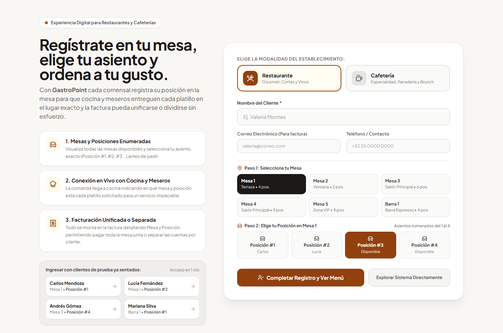
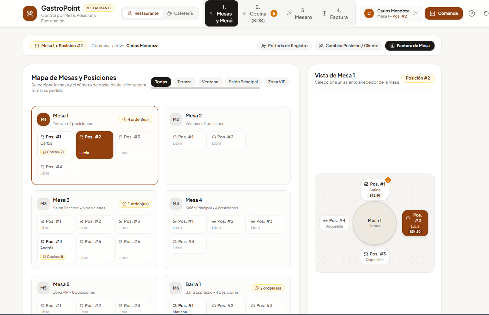
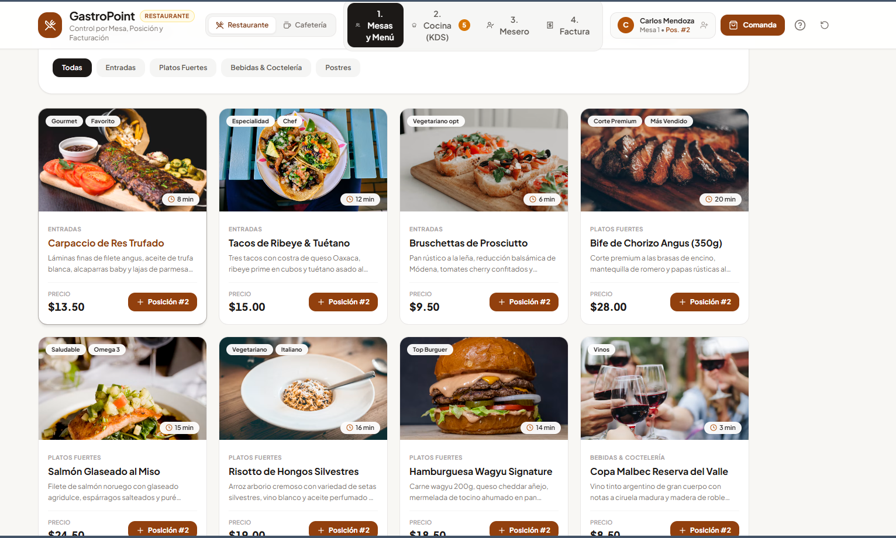
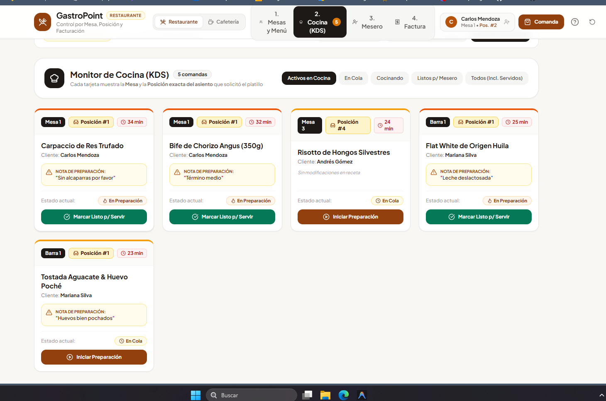
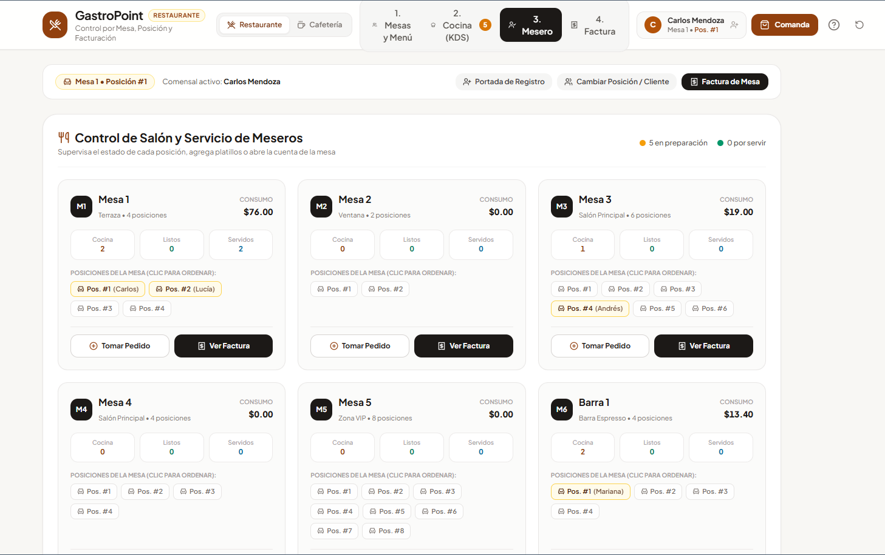
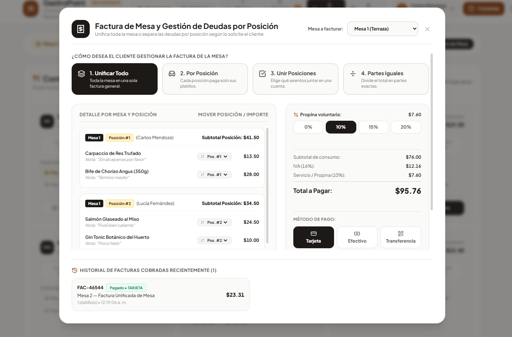

# 🍽️ GastroPoint POS — Sistema Integral de Gestión para Restaurantes y Cafeterías



**GastroPoint POS** es una plataforma web interactiva diseñada para optimizar la operación en piso, cocina y caja de **restaurantes** y **cafeterías**. El sistema permite registrar comensales, administrar áreas y mesas en tiempo real, asignar pedidos exactamente a la **posición (asiento numerado)** de cada cliente dentro de la mesa, coordinar la preparación en cocina mediante un monitor **KDS (Kitchen Display System)**, gestionar el servicio de meseros y emitir facturación flexible con cuentas unificadas o separadas por posición.

---

## 🎥 Demostración en Video

A continuación puedes visualizar el recorrido completo por las funcionalidades del sistema:

https://github.com/AllanSoto/GastroPoint/raw/main/Proyecto_8_imagenes/gp_video.mp4

> 💡 *También puedes consultar el archivo de video directamente en [`./Proyecto_8_imagenes/gp_video.mp4`](./Proyecto_8_imagenes/gp_video.mp4).*

---

## ✨ Características Principales

### 1. Registro de Clientes y Asignación de Mesa / Posición
- **Ingreso guiado**: Registro rápido del comensal con nombre, teléfono de contacto, nota o preferencia alimentaria, selección de mesa disponible y asiento específico (`Posición #1`, `Posición #2`, etc.).
- **Perfiles de demostración rápida**: Acceso instantáneo para pruebas operativas en un clic.
- **Doble giro gastronómico**: Conmutación inmediata entre modo **Restaurante** y modo **Cafetería Especializada**, adaptando el catálogo de platillos y bebidas.


---

### 2. Mapa de Mesas, Gestión de Áreas y Vista Arquitectónica 2D
- **Administración de Áreas (Zonas)**: Creación de nuevas zonas (*Salón Principal*, *Terraza Jardín*, *Barra & Café*, *Área VIP*) y edición del nombre del área activa en cualquier momento.
- **Gestión Dinámica de Mesas**: Creación y edición de mesas configurando nombre, capacidad de asientos (`2 a 12 posiciones`), área asignada y estado operativo (**Disponible**, **Reservada** u **Ocupada**).
- **Plano Interactivo 2D**: Representación visual de la mesa seleccionada con sus asientos numerados alrededor, indicando con código de colores la posición seleccionada, posiciones con consumo activo y lugares libres.
- **Módulo de Reservaciones**: Agenda dedicada por fecha, hora, número de personas, área y mesa con control de *Check-In* y liberación de mesas.



---

### 3. Catálogo de Menú y Comanda por Posición
- **Carta categorizada con buscador**: Filtrado ágil por entradas, platos fuertes, bebidas, postres o cafetería, con etiquetas dietéticas e indicadores de tiempo de preparación.
- **Asignación directa por asiento**: Cada platillo o bebida agregado a la comanda queda vinculado al número de posición del comensal que lo solicitó, permitiendo además cambiar de asiento con un solo clic o añadir notas especiales para cocina (*"Término medio"*, *"Sin cebolla"*, etc.).



---

### 4. Monitor de Cocina en Tiempo Real — KDS (Kitchen Display System)
- **Clasificación clara por Mesa y Posición**: Cada tarjeta de preparación muestra de forma destacada el número de mesa y el badge `Posición #N`, junto con el nombre del comensal y observaciones culinarias.
- **Flujo de estados de preparación**: Filtro y transición de platillos entre estados **En Cola (Pendiente)**, **En Fuego (Preparando)** y **Listos para Servir**, además de un botón de avance rápido para toda la mesa.



---

### 5. Control de Salón y Servicio de Meseros
- **Alertas de platillos listos para entrega**: Notificación inmediata de los platillos terminados por cocina indicando exactamente a qué **Mesa** y a qué **Posición (# de silla)** debe entregarse cada plato, evitando confusiones en el servicio.
- **Resumen integral de ocupación**: Vista general de todas las mesas con desglose de comensales por asiento, estado de sus platillos y acceso directo a la comanda o al cierre de cuenta.



---

### 6. Facturación Flexible por Mesa y Posición + Impresión de Tickets
El módulo de caja e historial de facturación resuelve cualquier escenario de cobro grupal o individual:
1. **Unificar Todo (1 Cuenta)**: Consolida el consumo de todas las posiciones de la mesa en una sola factura general.
2. **Separar por Posición**: Genera cuentas individuales por cada asiento (`Posición #1`, `Posición #2`, etc.), permitiendo cobrar y liquidar cada posición de forma independiente.
3. **Unir Posiciones Específicas**: Permite agrupar asientos seleccionados en una misma sub-cuenta (por ejemplo, `Posición #1 + Posición #3` pagan juntos).
4. **Dividir en Partes Iguales**: Prorratea el total de la mesa equitativamente entre `N` personas.
- **Reasignación de platillos en vivo**: Permite mover cualquier platillo de una posición a otra antes de emitir el cobro.
- **Impresión de Ticket Térmico / Fiscal**: Generación de vista previa e impresión directa con desglose por posición, subtotal, IVA (13%), propina configurable, método de pago (*Efectivo*, *Tarjeta* o *SINPE / Transferencia*) e historial de facturas emitidas con opción de reimpresión.



---

## 🛠️ Tecnologías Utilizadas

- **Frontend**: [React 18](https://react.dev/) (Hooks, Context API y persistencia de estado en `localStorage`)
- **Estilos y Diseño UI**: [Tailwind CSS](https://tailwindcss.com/) con paleta corporativa cálida de alta legibilidad
- **Iconografía**: [Lucide React](https://lucide.dev/)
- **Empaquetador y Entorno de Desarrollo**: [Vite](https://vitejs.dev/)

---

## 🚀 Instalación y Ejecución Local

### Prerrequisitos
- Contar con [Node.js](https://nodejs.org/) (versión 18 o superior recomendada) instalado en el equipo.

### Pasos de instalación

1. **Clonar el repositorio:**
   ```bash
   git clone https://github.com/AllanSoto/GastroPoint.git
   cd GastroPoint
   ```

2. **Instalar las dependencias:**
   ```bash
   npm install
   ```

3. **Iniciar el servidor de desarrollo:**
   ```bash
   npm run dev
   ```
   *(En sistemas Windows también puedes ejecutar directamente el archivo `iniciar.bat`).*

4. **Construir para producción (opcional):**
   ```bash
   npm run build
   ```

---

## 📂 Estructura del Proyecto

```text
GastroPoint/
├── Proyecto_8_imagenes/           # Capturas de pantalla y video demostrativo
├── src/
│   ├── components/
│   │   ├── WelcomeRegistrationPage.jsx  # Portada de bienvenida y registro de clientes
│   │   ├── Navbar.jsx                   # Barra superior de flujo operativo (4 pasos)
│   │   ├── TableSelector.jsx            # Mapa de áreas, mesas y asientos numerados
│   │   ├── InteractiveTable2D.jsx       # Esquema visual 2D de la mesa y sus posiciones
│   │   ├── MenuCatalog.jsx              # Catálogo gastronómico y asignación por asiento
│   │   ├── TableOrderSummary.jsx        # Seguimiento en vivo de platillos por posición
│   │   ├── CartDrawer.jsx               # Bandeja de comanda previa al envío a cocina
│   │   ├── KitchenDisplay.jsx           # Monitor de cocina (KDS) con alertas por posición
│   │   ├── WaiterView.jsx               # Panel de meseros y despacho a mesa/asiento
│   │   ├── BillingModal.jsx             # Facturación en 4 modos e historial de tickets
│   │   ├── ReservationsModal.jsx        # Sistema de reservaciones por fecha, hora y personas
│   │   ├── CustomerRegistration.jsx     # Modal de gestión de clientes registrados
│   │   └── NotificationToast.jsx        # Notificaciones operativas en tiempo real
│   ├── context/
│   │   └── RestaurantContext.jsx        # Estado centralizado de mesas, áreas, órdenes y pagos
│   ├── data/
│   │   └── mockData.js                  # Datos iniciales de zonas, mesas, menús y reservas
│   ├── utils/
│   │   └── printInvoice.js              # Motor de impresión para tickets térmicos/fiscales
│   ├── App.jsx                          # Enrutador de vistas e integración de modales
│   ├── main.jsx                         # Punto de entrada de la aplicación
│   └── index.css                        # Estilos base y configuración de impresión
├── index.html
├── package.json
├── tailwind.config.js
└── vite.config.js
```

---

## 👤 Autor

Desarrollado por **Allan Soto** — [GitHub @AllanSoto](https://github.com/AllanSoto)
